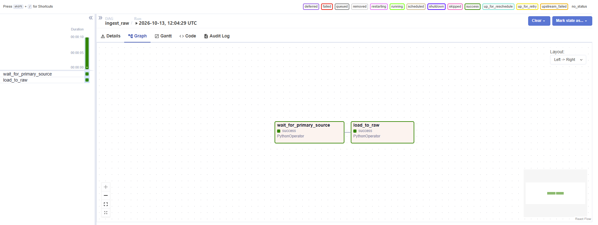
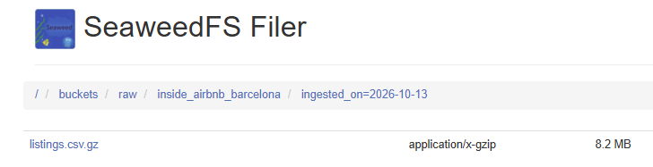
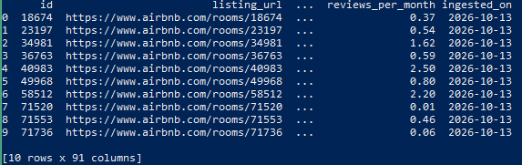

# Доказательства ЛР2

## 1. Граф DAG ingest_raw

Обе задачи (`wait_for_primary_source` и `load_to_raw`) завершены успешно.

## 2. Бакет raw в SeaweedFS
)

Файл `listings.csv.gz` загружен с партиционированием по `ingested_on`.

## 3. Проверка через DuckDB
)

Файл успешно прочитан из SeaweedFS через `scripts/read_raw.py`.
